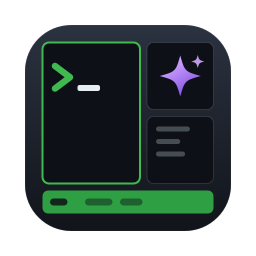
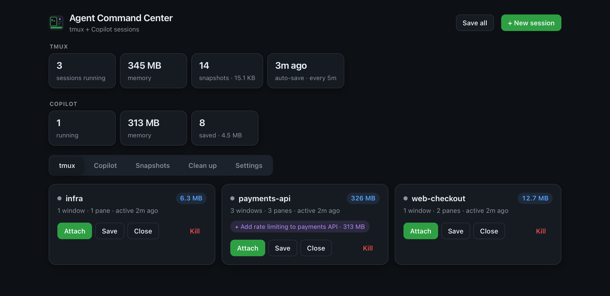
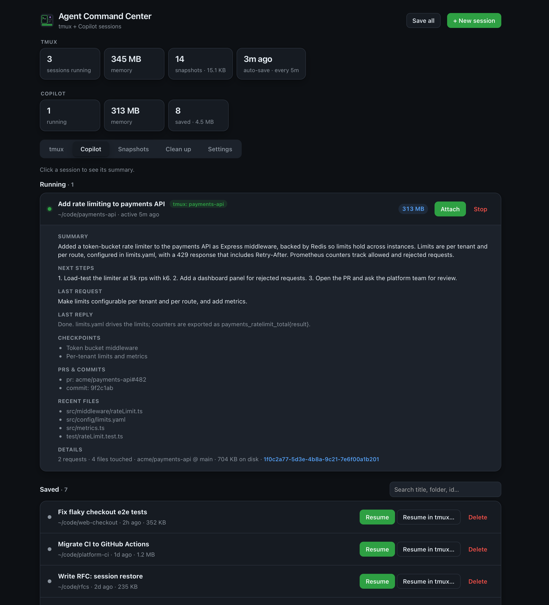
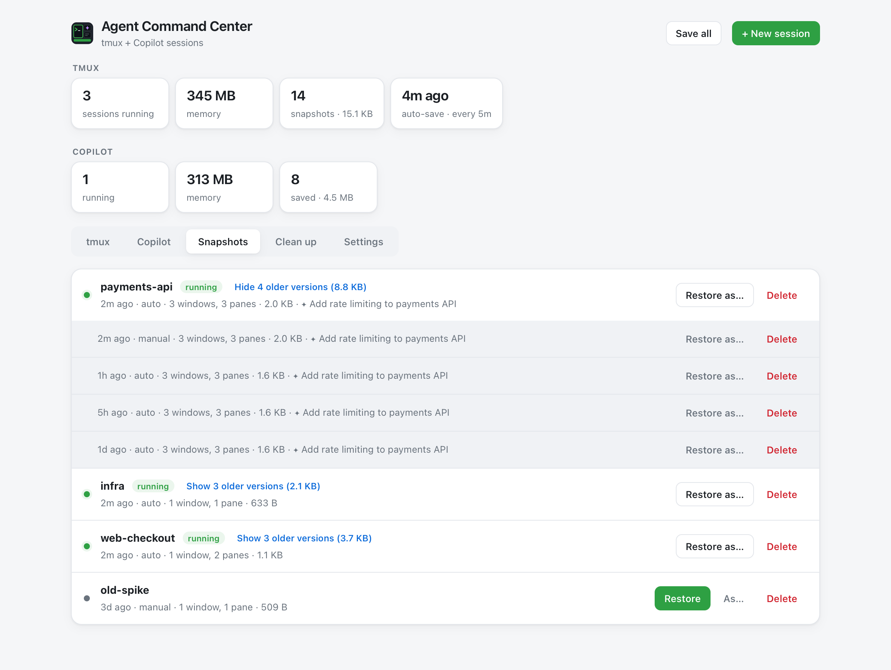
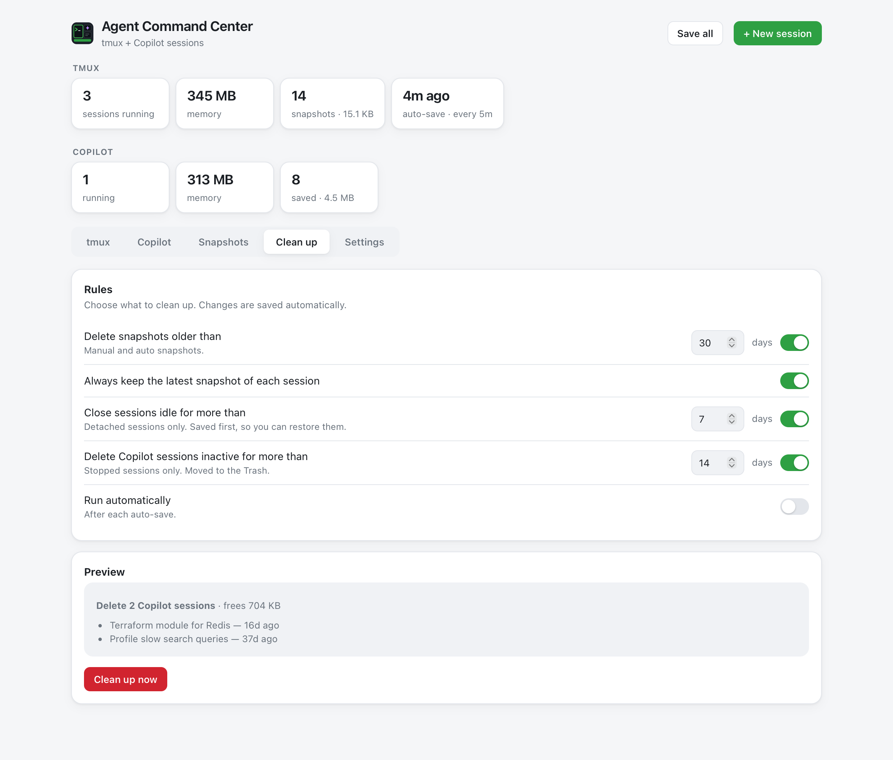
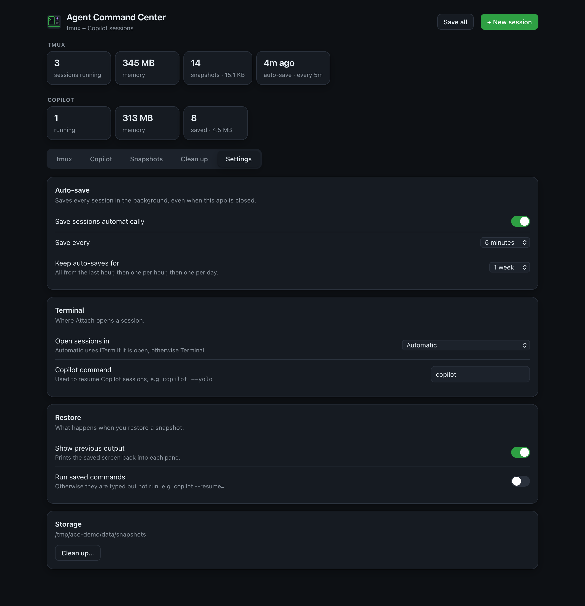

<p align="center">
  
</p>

<h1 align="center">Agent Command Center</h1>

<p align="center">
  <b>Manage your local tmux and Copilot CLI sessions from one Mac app.</b><br>
  Auto-save and restore tmux, see what's using memory, and summarize, resume, move or clean up Copilot sessions.
</p>

<p align="center">
  <a href="https://github.com/youminhan/agent-command-center/releases/latest"></a>
  
  
  <a href="LICENSE"></a>
</p>

---

## Why

- **Your machine restarts and tmux is gone.** Agent Command Center saves every tmux session in the
  background and puts it back, with its windows, panes, folders and screen contents.
- **AI coding agents pile up.** Each idle Copilot CLI session can hold a gigabyte or more. See them all,
  what they were doing, and stop, resume or delete them.
- **One place, no terminal juggling.** A Dock app and a menu-bar icon, with nothing to configure.

## Screenshots

<p align="center"></p>

<table>
  <tr>
    <td></td>
    <td></td>
  </tr>
  <tr>
    <td align="center"><sub>Copilot: running and saved sessions, with summaries</sub></td>
    <td align="center"><sub>Snapshots: one row per session, older versions underneath</sub></td>
  </tr>
  <tr>
    <td></td>
    <td></td>
  </tr>
  <tr>
    <td align="center"><sub>Clean up: rules and a preview before anything is deleted</sub></td>
    <td align="center"><sub>Settings: auto-save, terminal, restore</sub></td>
  </tr>
</table>

<sub>Screenshots use demo data.</sub>

## Features

**tmux**

- **Auto-save** every session in the background, even when the app is closed (every 1 to 60 minutes).
- **Restore** a session's windows, panes, layout, folders and screen output after a reboot.
  Saved commands are typed back in, and run if you choose.
- **Memory per session**, and which Copilot session is running inside it.
- **Attach, save, close or kill** from the window or the menu bar.
- **Snapshots grouped per session.** Auto-saves thin out over time: all from the last hour,
  then one per hour for a day, then one per day for as long as you choose.

**Copilot CLI**

- **Every session in one list:** running ones with memory and where they run (tmux, Termius, iTerm…),
  and all saved ones, searchable.
- **Summaries:** the latest checkpoint overview, next steps, last request and reply,
  PRs and commits, and files touched, read from Copilot's own local records.
- **Resume** in your terminal, or **in tmux**: a new tmux session or a new window in an existing one.
- **Move to tmux:** take a session running in a plain terminal tab and continue it inside tmux,
  so it survives closing the window.
- **Stop** to free memory, **Delete** to free disk (moved to the Trash).

**Clean up**

- Delete snapshots older than N days, always keeping each session's latest.
- Save and close tmux sessions that have been idle for N days.
- Delete Copilot sessions inactive for N days.
- Preview what will happen first, or run it automatically after each auto-save.

## Installation

1. Download **AgentCommandCenter.dmg** from the [latest release](https://github.com/youminhan/agent-command-center/releases/latest).
2. Open it and double-click **Install.command**. It copies the app to Applications and opens it.

   Or drag **Agent Command Center** to Applications. The app isn't notarized yet, so the first time
   right-click it and choose **Open**.

On first launch it sets up its data folder, the background auto-save job and open-at-login.
Nothing else to configure.

### Requirements

| | |
|---|---|
| macOS | 13 Ventura or later, Apple Silicon or Intel |
| tmux | `brew install tmux` |
| Python 3 | Homebrew's, or Apple's (`xcode-select --install`) |
| Copilot CLI | optional, for the Copilot features |

The app tells you if something is missing.

## Usage

| Where | What |
|---|---|
| **Dock / window** | The full app: tmux, Copilot, Snapshots, Clean up and Settings tabs. |
| **Menu bar** (▥ icon) | Running sessions, Save All, Restore, and Copilot memory at a glance. |
| **Attach** | Opens the session in iTerm or Terminal. Using Termius, Warp or another terminal? Set **Settings → Terminal → Copy command** and paste it. |
| **Copilot command** | Set **Settings → Copilot command** to how you start Copilot, for example `copilot --yolo`. |

### Where things live

| | |
|---|---|
| Snapshots and settings | `~/Library/Application Support/Agent Command Center/` |
| Auto-save job | `~/Library/LaunchAgents/com.agentcommandcenter.autosave.plist` |
| Copilot sessions (read) | `~/.copilot/session-state/` and `~/.copilot/session-store.db` |

### Uninstall

```sh
launchctl bootout gui/$(id -u)/com.agentcommandcenter.autosave
rm ~/Library/LaunchAgents/com.agentcommandcenter.autosave.plist
rm -rf "/Applications/Agent Command Center.app" "$HOME/Library/Application Support/Agent Command Center"
```

## Building from source

```sh
git clone https://github.com/youminhan/agent-command-center.git
cd agent-command-center/macapp
./build.sh            # builds the app and dist/AgentCommandCenter.{dmg,zip}
./build.sh --install  # also installs it into /Applications and opens it
```

Needs the Xcode Command Line Tools (`swiftc`). No other dependencies.

You can also run the backend on its own and use it in a browser:

```sh
python3 app.py --port 8765        # then open http://127.0.0.1:8765
python3 app.py --save-all --force # take an auto-save now
```

### How it works

- `app.py` is a small, dependency-free Python server. It talks to `tmux`, reads Copilot's local
  session files, and serves a JSON API on `127.0.0.1` only. Write requests need a custom header,
  so other websites can't call it.
- `ui.html` is the interface.
- `macapp/` is a native Swift wrapper: Dock app, menu-bar icon, window, terminal integration and the
  auto-save LaunchAgent. The app icon is drawn in code (`icon.swift`).

## License

[Apache License 2.0](LICENSE)
