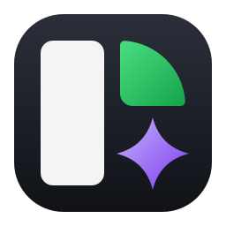
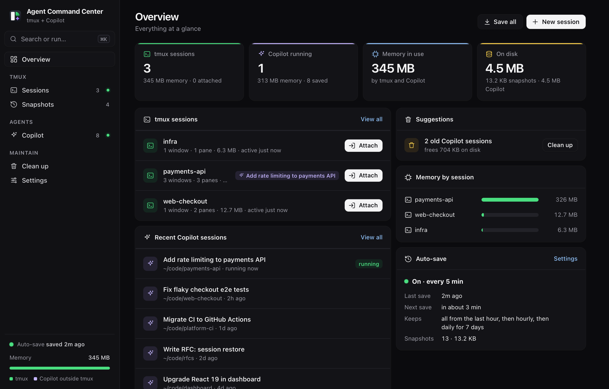
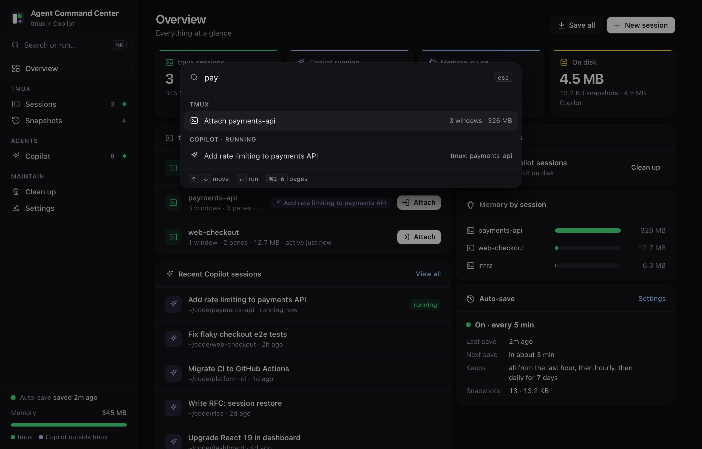

<div align="center">



# Agent Command Center

**Mission control for your terminal sessions and AI coding agents, on your Mac.**

Never lose a tmux session to a restart. See every Copilot CLI agent, what it's doing and what it costs your memory.<br>
Resume, move or clean it all up from one native app.

[](https://github.com/youminhan/agent-command-center/releases/latest)
[](https://github.com/youminhan/agent-command-center/releases)
[](#requirements)
[](#requirements)
[](LICENSE)
[](CONTRIBUTING.md)

[**Download**](https://github.com/youminhan/agent-command-center/releases/latest) ·
[Features](#features) ·
[Quick start](#quick-start) ·
[How it works](#how-it-works) ·
[FAQ](#faq) ·
[Contributing](#contributing)

<br>



</div>

<br>

## Why

You run long tmux sessions and a handful of AI coding agents. Then:

- **macOS restarts and every tmux session is gone**, along with its layout and history.
- **Idle agents quietly hold a gigabyte or more each**, and you can't tell which tab is which.
- **Old agent sessions pile up on disk**, and finding the one you want means scrolling `--resume` IDs.

Agent Command Center keeps all of it saved, visible and one click away.

## Features

<table>
<tr>
<td width="50%" valign="top">

### 🖥 tmux, saved and restorable
- Background **auto-save** of every session (every 1–60 min), even with the app closed
- **Restore** windows, panes, layout, folders and screen output after a reboot
- **Memory per session**, and which agent runs inside it
- Attach, save, close or kill from the window, menu bar or <kbd>⌘K</kbd>
- Snapshots **thin out over time**: every save for an hour, then hourly, then daily

</td>
<td width="50%" valign="top">

### ✦ Copilot CLI agents, under control
- **Every session** in one list: running ones with memory and where they run, saved ones searchable
- **Summaries** from Copilot's own records: overview, next steps, last request, PRs, files
- **Resume** in your terminal, or **in tmux** as a new session or a window in an existing one
- **Move to tmux**: rescue an agent running in a plain tab so it survives closing the window
- **Stop** to free memory, **Delete** to free disk (moved to the Trash)

</td>
</tr>
<tr>
<td valign="top">

### 🧹 Clean up with a preview
- Delete snapshots older than N days, always keeping each session's latest
- Save and close tmux sessions idle for N days
- Delete agent sessions inactive for N days
- See exactly what will happen first, or run it after every auto-save

</td>
<td valign="top">

### ⚡ Built like a native tool
- Native Dock app and **menu-bar icon**, translucent sidebar, light and dark
- **Command palette** <kbd>⌘K</kbd> and shortcuts for everything
- Keyboard and screen-reader friendly; respects Reduce Motion
- **No account, no telemetry, no network**: it all stays on your Mac

</td>
</tr>
</table>

<details>
<summary><b>More screenshots</b></summary>
<br>

| Copilot session summary | tmux sessions |
|---|---|
|  |  |
| **Command palette** | **Snapshots** |
|  |  |
| **Clean up** | **Settings** |
|  |  |

<sub>Screenshots use demo data, generated by <code>scripts/screenshots.sh</code>.</sub>
</details>

## Quick start

1. **Download** `AgentCommandCenter.dmg` from the [latest release](https://github.com/youminhan/agent-command-center/releases/latest).
2. **Open it and double-click `Install.command`.** It copies the app to Applications and launches it.
3. **That's it.** On first launch it creates its data folder, starts background auto-save and adds itself to login items.

> [!NOTE]
> The app isn't notarized yet. If you drag it to Applications instead of using `Install.command`,
> right-click the app and choose **Open** the first time.

### Requirements

| | |
|---|---|
| **macOS** | 13 Ventura or later, Apple silicon or Intel |
| **tmux** | `brew install tmux` |
| **Python 3** | Homebrew's, or Apple's via `xcode-select --install` |
| **Copilot CLI** | Optional, for the agent features |

The app tells you if something is missing and how to install it.

## Usage

| Where | What you get |
|---|---|
| **Window** | Overview, Sessions, Snapshots, Copilot, Clean up and Settings |
| **Menu bar** | Running sessions, Save All, Restore and agent memory at a glance |
| **<kbd>⌘K</kbd>** | Jump to any session, agent or snapshot, or run an action |

### Keyboard shortcuts

| Keys | Action |
|---|---|
| <kbd>⌘</kbd> <kbd>K</kbd> | Command palette |
| <kbd>⌘</kbd> <kbd>1</kbd> … <kbd>6</kbd> | Switch pages |
| <kbd>/</kbd> | Filter agent sessions |
| <kbd>esc</kbd> | Close the panel, palette or dialog |

## Configuration

Everything is in **Settings** and saves as you change it.

| Setting | Default | Notes |
|---|---|---|
| Auto-save | On, every 5 min | Runs in the background via a LaunchAgent |
| Keep auto-saves for | 1 week | All from the last hour, then hourly, then daily |
| Open sessions in | Automatic | iTerm if it's open, otherwise Terminal. Use **Copy command** for Termius, Warp and others |
| Copilot command | `copilot` | How you start Copilot, for example `copilot --yolo` |
| Restore: show previous output | On | Prints the saved screen back into each pane |
| Restore: run saved commands | Off | Otherwise they're typed but not run |

<details>
<summary><b>Where files live</b></summary>
<br>

| | |
|---|---|
| Snapshots and settings | `~/Library/Application Support/Agent Command Center/` |
| Auto-save job | `~/Library/LaunchAgents/com.agentcommandcenter.autosave.plist` |
| Copilot sessions (read, and moved to the Trash on delete) | `~/.copilot/session-state/` and `~/.copilot/session-store.db` |
</details>

## How it works

```
┌────────────────────────┐   JSON over 127.0.0.1   ┌─────────────────────┐
│ Agent Command Center   │ ──────────────────────▶ │ app.py              │ ──▶ tmux
│ Swift: window, menu    │                         │ Python, stdlib only │ ──▶ ~/.copilot (read)
│ bar, LaunchAgent       │ ◀── ui.html (WebKit) ── │                     │ ──▶ snapshots
└────────────────────────┘                         └─────────────────────┘
            ▲
            └── launchd runs `app.py --save-all` every minute; it saves only when due.
```

- **`app.py`**: a small, dependency-free server that talks to `tmux`, reads Copilot's local session files and serves the UI and a JSON API.
- **`ui.html`**: the whole interface in one file. No build step, no framework.
- **`macapp/`**: the native Swift shell: window, menu bar, terminal integration, login item, auto-save job, and the icon drawn in code.

### Privacy and security

- Runs entirely on your Mac and makes **no network requests**.
- The server listens on **`127.0.0.1` only**. Requests that change anything need a custom header, so other websites can't trigger them.
- Copilot data is only read, except **Delete**, which moves a session folder to the Trash.

Found a problem? See [SECURITY.md](SECURITY.md).

## FAQ

<details>
<summary><b>Does it work with Claude Code, Codex or other agents?</b></summary>
<br>
tmux features work with anything you run in tmux. The agent features currently read GitHub Copilot CLI's session files. Support for other agents is on the <a href="#roadmap">roadmap</a>.
</details>

<details>
<summary><b>Will restoring a session restart my programs?</b></summary>
<br>
It recreates windows, panes, layout and folders, and types each pane's last command back in. Commands only run if you turn on <b>Run saved commands</b>. Copilot sessions come back with <code>--resume</code>, so the conversation continues.
</details>

<details>
<summary><b>I use Termius, Warp or another terminal.</b></summary>
<br>
Set <b>Settings → Terminal → Copy command</b>. Attach and Resume copy the command so you can paste it anywhere.
</details>

<details>
<summary><b>Can I use it without the Mac app?</b></summary>
<br>
Yes. Run <code>python3 app.py</code> and open <code>http://127.0.0.1:8765</code>. Add <code>python3 app.py --save-all</code> to cron or launchd for auto-save.
</details>

<details>
<summary><b>How do I uninstall it?</b></summary>
<br>

```sh
launchctl bootout gui/$(id -u)/com.agentcommandcenter.autosave
rm ~/Library/LaunchAgents/com.agentcommandcenter.autosave.plist
rm -rf "/Applications/Agent Command Center.app" \
       "$HOME/Library/Application Support/Agent Command Center"
```
</details>

## Building from source

```sh
git clone https://github.com/youminhan/agent-command-center.git
cd agent-command-center/macapp
./build.sh --install   # universal app in /Applications, plus dist/*.dmg and *.zip
```

Needs only the Xcode Command Line Tools. To work on the UI, run `python3 app.py` and reload the browser.

## Roadmap

- [ ] Homebrew cask
- [ ] Signed and notarized releases
- [ ] Claude Code and Codex session support
- [ ] Restore running programs, not just their commands
- [ ] Per-session notes and tags

Have an idea? [Open an issue](https://github.com/youminhan/agent-command-center/issues/new/choose).

## Contributing

Contributions are welcome, from typo fixes to new features. Read [CONTRIBUTING.md](CONTRIBUTING.md) to get set up, and see [CHANGELOG.md](CHANGELOG.md) for what's changed.

## License

[Apache License 2.0](LICENSE) © Youmin Han
